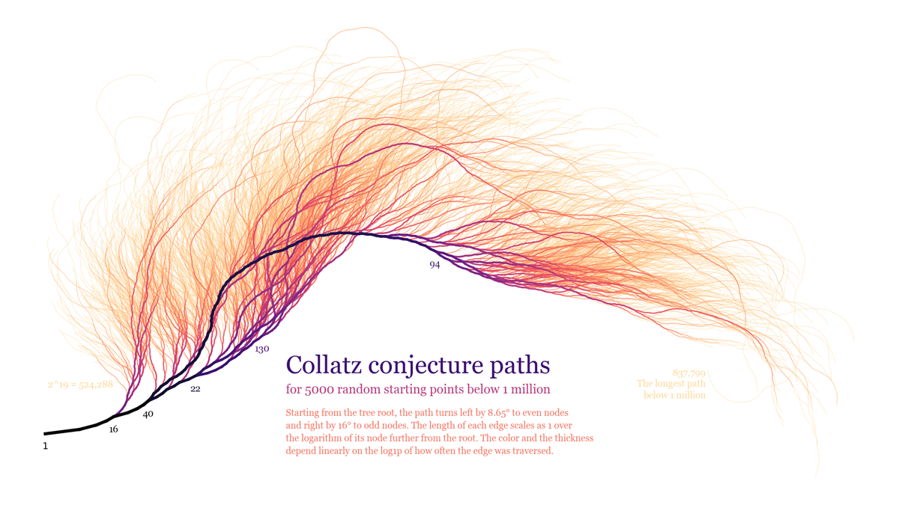

# Collatz tracker

**Live page:** [christophermayes.github.io/collatz-tracker](https://christophermayes.github.io/collatz-tracker/)

This page draws the Collatz conjecture tree in the browser in real time, continuously adding new paths so the picture never stops changing.
It reproduces the style of the figure by Dmitry Kobak that illustrates the [Collatz conjecture](https://en.wikipedia.org/wiki/Collatz_conjecture) article on Wikipedia.



*Reference figure: [Collatz conjecture tree visualization](https://commons.wikimedia.org/wiki/File:Collatz_conjecture_tree_visualization.png) by Dmitry Kobak, CC0 1.0.*

## The Collatz conjecture

For a positive integer `n`, the Collatz map sends `n` to `n / 2` if `n` is even and to `3n + 1` if `n` is odd.
The conjecture states that repeatedly applying this map eventually reaches 1 from every starting value.
Because the paths from different starting values merge as they descend, their union forms a tree rooted at 1.

## The visualization

The drawing rules follow the reference figure:

- Starting values are random integers below 1,000,000.
- Each path is drawn outward from the root at 1, turning left by 8.65° into an even number and right by 16° into an odd number.
- The length of each edge is `1 / log(n)`, where `n` is the node of the edge farther from the root.
- The color and thickness of each edge depend linearly on `log1p` of the number of paths that traverse it, using the magma colormap: rarely used edges are thin and light, and the shared trunk is thick and dark.

By default, the page adds 10 random paths per animation frame and keeps the 5,000 most recent.
Once that window is full, each new path replaces the oldest one, so the trunk remains stable while the outer branches change continuously.

## Parameters

The Parameters panel on the page has a slider and a text box for each setting. The Reset button restores the values of the reference figure.

| Parameter | Default | Effect |
| --- | --- | --- |
| Even turn (deg) | 8.65 | Left turn into an even number. |
| Odd turn (deg) | 16 | Right turn into an odd number. |
| Max start | 1,000,000 | Upper bound for random starting values, up to 10⁹. |
| Paths shown | 5,000 | Number of most recent paths kept in the tree. |
| New paths per frame | 10 | Rate at which new paths are added. Zero pauses the animation. |
| Min line width (px) | 0.4 | Width of the least traversed edges. |
| Max line width (px) | 7.4 | Width of the most traversed edges. |

Changing a turn angle redraws all current paths with the new geometry.
Paths whose values would exceed 2⁵³, the largest integer a JavaScript number represents exactly, are skipped; below 10⁹ this affects very few starting values.

## Implementation

The page is written in TypeScript with no framework, built with [Vite](https://vite.dev/), and drawn on an HTML canvas.

Each node's position and heading depend only on its path to 1, so they are computed once and cached.
A new starting value therefore only adds the few segments needed to reach a node already in the tree.
Every frame, the edges are grouped into 48 levels by traversal count and drawn from the lightest level to the darkest.

- [src/collatz.ts](src/collatz.ts) maintains the tree, the cached geometry, and the edge traversal counts.
- [src/controls.ts](src/controls.ts) builds the slider and text box for each parameter.
- [src/main.ts](src/main.ts) handles the parameters, the animation loop, the colormap, and the drawing.

## Local development

Node.js is provided by a conda environment:

```sh
conda create -n collatz -c conda-forge nodejs
conda activate collatz
npm install
npm run dev      # development server at http://localhost:5173/
npm run build    # type-check and build the static site into dist/
```

Every push to `main` builds the site and deploys it to GitHub Pages through [.github/workflows/deploy.yml](.github/workflows/deploy.yml).

## Credits

- The reference figure and its drawing rules are by Dmitry Kobak ([Wikimedia Commons](https://commons.wikimedia.org/wiki/File:Collatz_conjecture_tree_visualization.png)), whose original Python notebook is available at [dkobak/collatz-viz](https://github.com/dkobak/collatz-viz). Both are dedicated to the public domain under CC0 1.0.
- Kobak credits as inspiration a [Mathematica Stack Exchange answer](https://mathematica.stackexchange.com/a/85731) and the [Reddit post](https://www.reddit.com/r/math/comments/38cg9r/a_beautiful_picture_related_to_collatz_conjecture/) that prompted it.
- The magma colormap was created by Stéfan van der Walt and Nathaniel Smith for matplotlib. This page interpolates between nine sampled colors from it.

## Acknowledgement

The code, deployment workflow, and this README were written by Claude Opus 5.5, running as GitHub Copilot in Visual Studio Code, at the direction of Christopher Mayes.
The page was tested locally and on the deployed site before publication.
